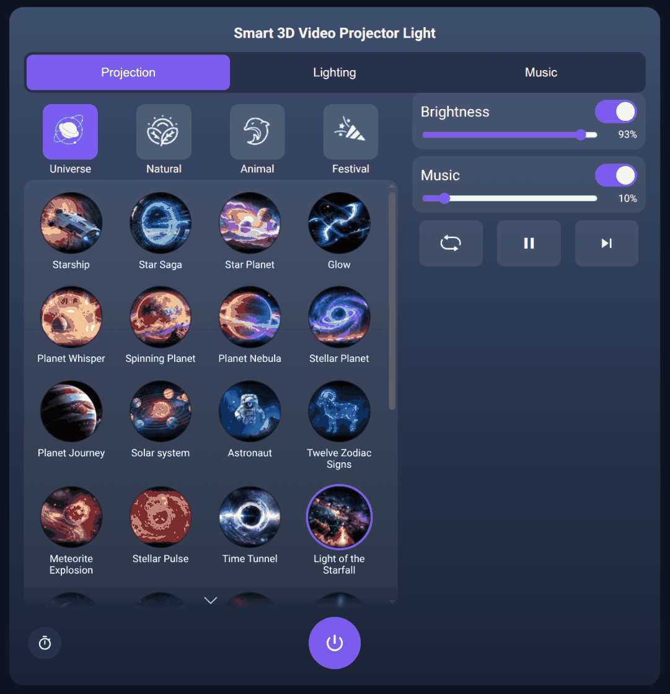
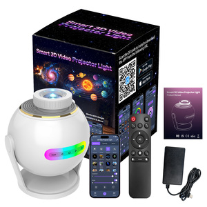
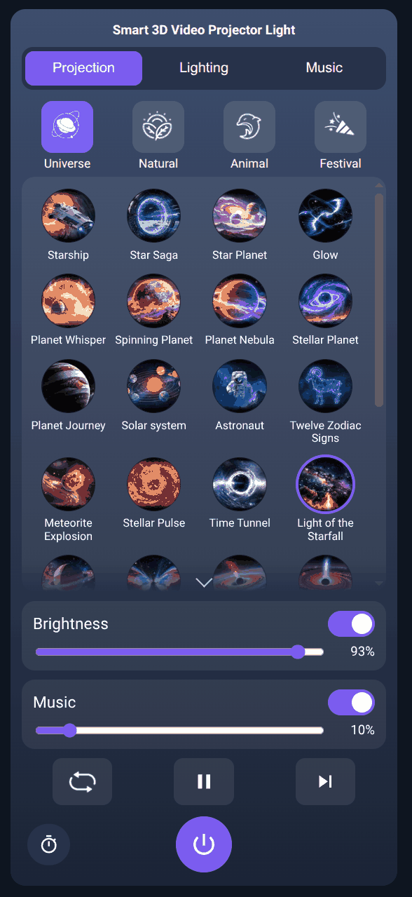
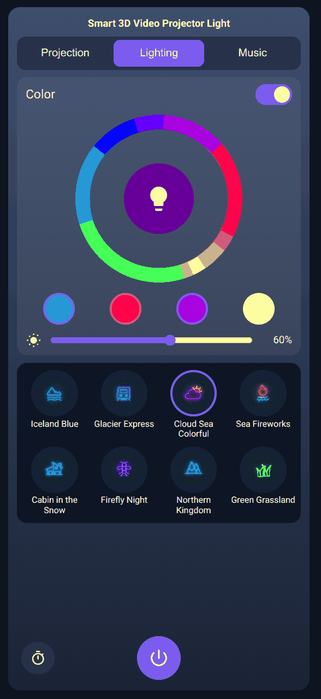
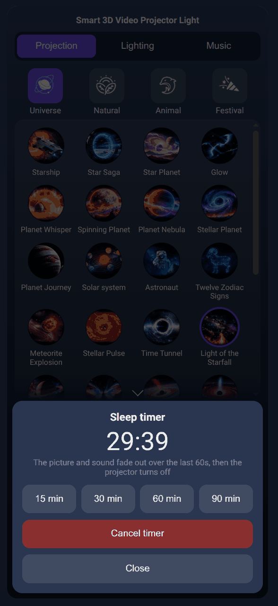

# Smart 3D Video Projector Light (SK19 Pro) for Home Assistant

[](https://hacs.xyz)
[](https://github.com/mjpowersjr/tuya-sk19-pro/releases)

Local control of the cheap Tuya **"Smart 3D Video Projector Light"** (galaxy / star projector with a
Bluetooth speaker, sold as *SK19 Pro* and under similar names) from Home Assistant, **no cloud and no
app needed day to day**, plus an app-style control card, a scene catalogue with the app's own names
and icons, and a sleep timer.

<p align="center">
  
</p>

## What you get

- **Full local control** over the LAN (Tuya protocol 3.5, TCP 6668) via [Tuya Local](https://github.com/make-all/tuya-local):
  power, colour light, projection on/off and brightness, play/pause, sound, volume, Bluetooth,
  playback order, next/previous, and **all 60 projection scenes and 8 lighting scenes by name**.
- **A card that looks and behaves like the mobile app**: Projection / Lighting / Music tabs, the same
  names and icons, colour wheel, one-tap presets. Works on phones, tablets (portrait and landscape)
  and desktop; follows the projector as it advances scenes on its own.
- **Sleep timer**: 15/30/60/90 minute presets; dims the picture, fades the sound, then powers off,
  and verifies it actually turned off. Also available as services for automations.
- **One-click install** with HACS; the device definition is installed for you.
- Everything is local; the cloud is only used once, to fetch the device's local key.

## Is this the device?

<p align="center">
  <br>
  <sub>Product photo from the retail listing, shown only to help you identify the device.</sub>
</p>

Tuya product `a5enoboa4fnkicus` / category `xktyd`, listed as "Smart 3D Video Projector Light"
(or "Smart 3D Projector Light", "SK19 Pro"). A round white projector with a rainbow LED strip, a
remote, and a Smart Life / Tuya app QR code on the box. If the Smart Life app shows scenes called
*Starship, Galaxy, Solar system, Halloween Horror...* it's this one. Other Tuya projector lights
usually share most data points, so the device YAML here is a good starting point (see
[docs/HACKING.md](docs/HACKING.md)).

## Install

Requirements: Home Assistant with [HACS](https://hacs.xyz), the projector already set up in the
**Smart Life / Tuya app** once (to get its local key), and its IP address.

1. **HACS → ⋮ → Custom repositories** → `https://github.com/mjpowersjr/tuya-sk19-pro`, type
   **Integration**.
2. Download **SK19 Pro Projector**, and **Tuya Local** (custom repo `make-all/tuya-local` if it
   isn't in your HACS list). **Restart Home Assistant.**
3. **Settings → Devices & services → Add integration → SK19 Pro Projector** (one click). This
   installs the device definition and adds a **Projector** sidebar entry. If it says the device
   config was installed, restart Home Assistant once more.
4. **Add integration → Tuya Local**: enter the device ID, host and local key
   ([how to get them](#getting-the-local-key)) and choose **Projector light**.

That's it. The card finds the entities by itself.

### Dashboard (optional)

The sidebar panel works out of the box. If you want the projector as a dashboard (for example the
default dashboard of a wall tablet): **Settings → Dashboards → Add dashboard → New from scratch**,
title `Projector`, URL `sk19-dashboard`, then in the raw editor:

```yaml
views:
  - title: Projector
    path: projector
    panel: true
    cards:
      - type: custom:sk19-projector-card
```

The integration hides its own sidebar entry when that dashboard exists. The card is also usable
inside any dashboard as `type: custom:sk19-projector-card`.

### Getting the local key

1. Create a free project on the [Tuya IoT Platform](https://iot.tuya.com) (data centre matching
   your app account) and link your Smart Life account (*Devices → Link App Account*).
2. *Cloud → API Explorer → Device Management → Query Device Details* with your device ID; copy
   `local_key`.
3. Give the projector a DHCP reservation so its IP doesn't change. Re-pairing the device in the app
   rotates the key.

## Sleep timer

Tap the timer button (bottom-left of the card) and pick 15 / 30 / 60 / 90 minutes. For the last
60 seconds the picture dims and the sound fades; then the projector turns off and your levels are
put back for next time. Switching it off by hand cancels the timer. It survives restarts.

For automations:

```yaml
action: sk19_pro.start_timer
data:
  minutes: 45
  fade_seconds: 60        # optional; 0 disables the fade
---
action: sk19_pro.cancel_timer
```

State: `sk19_pro.sleep_timer` (`running` / `idle`, attributes `end`, `minutes`, `fade_seconds`,
and `last_run` for the previous result).

## Screenshots

| Phone | Lighting | Sleep timer |
|---|---|---|
|  |  |  |

## Documentation

- [Architecture](docs/ARCHITECTURE.md) - how the pieces fit, and why some things are the way they are
- [Hacking / contributing](docs/HACKING.md) - dev loop, regenerating assets, debugging on a tablet, releases
- [Data points](docs/DPS.md) - the device's DP map, scene indices, firmware notes
- [Research notes](docs/RESEARCH.md) - what the device can and can't do (no custom video), quirks
- [Troubleshooting](docs/TROUBLESHOOTING.md)

## Command line

`sk19.py` talks to the device directly (`status`, `set <dp> <value>`); copy
`sk19.example.toml` to `sk19.toml` (gitignored, `chmod 600`) or use `SK19_DEVICE_ID`, `SK19_HOST`,
`SK19_LOCAL_KEY`. Home Assistant holds the device's single LAN connection while it runs.

## Credits and notes

- Built on [Tuya Local](https://github.com/make-all/tuya-local) by @make-all.
- Scene names and icons come from the artwork in the device's Smart Life app panel and are included
  downsized, for use with the matching hardware.
- Not affiliated with Tuya or the device's maker. Use at your own risk.
